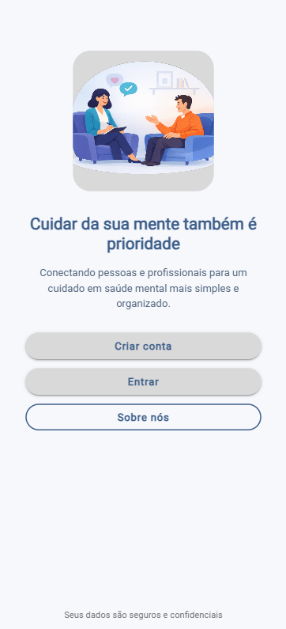
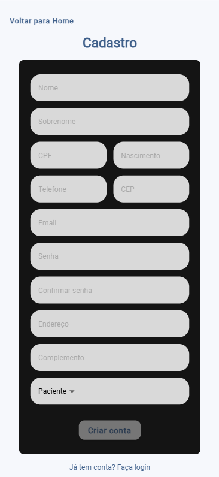
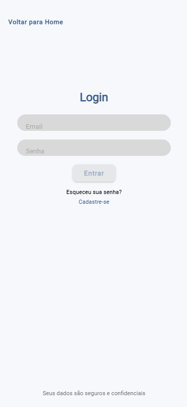
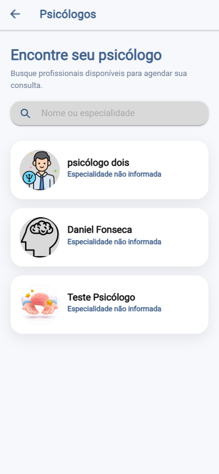
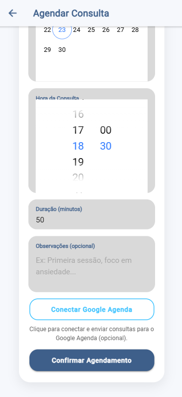
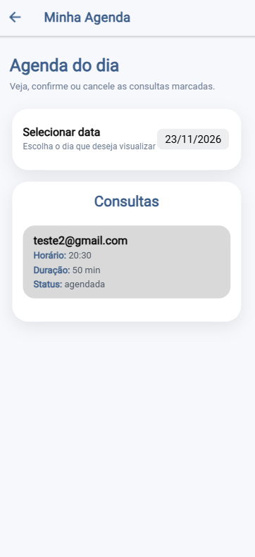

# Mindly

Aplicativo mobile de saúde mental que conecta **pacientes** e **psicólogos**, facilitando a organização de sessões, agendas e o acompanhamento entre os dois lados.

> Projeto desenvolvido na disciplina **Projeto em Aplicativos Mobile** (Análise e Desenvolvimento de Sistemas, UNISUAM, 2026), em equipe e com metodologia Scrum.

## Sobre

A psicologia é uma área em crescimento, mas ainda carece de ferramentas que apoiem tanto o profissional (gerenciar pacientes e agenda) quanto o paciente (encontrar um psicólogo e acompanhar as sessões). O Mindly nasceu para atender essas duas pontas em um único app.

Pacientes e psicólogos criam conta e, depois do login, cada um acessa um fluxo próprio, de acordo com o tipo de usuário escolhido no cadastro.

## Funcionalidades

**Para todos os usuários**
- Cadastro com tipo de usuário (paciente ou psicólogo) e login com e-mail e senha
- Perfil com dados do cadastro e foto de perfil (câmera nativa do celular ou galeria)
- Alteração de senha
- Tela "Sobre nós"

**Área do paciente**
- Busca de psicólogos por nome ou especialidade
- Visualização do perfil do profissional
- Agendamento de consultas (data, horário, duração e observações)
- Integração opcional com o **Google Agenda**
- Lista de próximos agendamentos

**Área do psicólogo**
- Agenda com os atendimentos por data
- Lista de pacientes

## Telas

<table>
  <tr>
    <td align="center"><b>Início</b><br></td>
    <td align="center"><b>Cadastro</b><br></td>
    <td align="center"><b>Login</b><br></td>
  </tr>
  <tr>
    <td align="center"><b>Busca de psicólogos</b><br></td>
    <td align="center"><b>Agendamento</b><br></td>
    <td align="center"><b>Agenda do psicólogo</b><br></td>
  </tr>
</table>

## Tecnologias

- **Angular** + **Ionic** (interface e navegação)
- **Capacitor** (acesso a recursos nativos, como a câmera, e build para Android)
- **TypeScript**
- **Firebase / Firestore** (banco de dados e regras de segurança)
- **Google OAuth** e **Google Calendar API** (login e integração de agenda)
- Android (geração de APK)

## Como rodar

Pré-requisitos: Node.js, Ionic CLI (`npm install -g @ionic/cli`) e um projeto Firebase próprio.

```bash
# 1. Clonar o repositório
git clone https://github.com/jlima20/Mindly.git
cd Mindly

# 2. Instalar as dependências
npm install

# 3. Configurar o Firebase e o Google (veja a documentação abaixo)

# 4. Rodar no navegador
ionic serve
```

Para gerar o app Android:

```bash
ionic build
npx cap sync android
npx cap open android
```

### Configuração

Os passos de configuração estão documentados em:

- [`FIRESTORE_RULES_SETUP.md`](FIRESTORE_RULES_SETUP.md): regras de segurança do Firestore
- [`FIRESTORE_INDEX_SETUP.md`](FIRESTORE_INDEX_SETUP.md): índices do Firestore
- [`GOOGLE_OAUTH_SETUP.md`](GOOGLE_OAUTH_SETUP.md): login com Google
- [`GOOGLE_CALENDAR_CONFIG.md`](GOOGLE_CALENDAR_CONFIG.md): integração com o Google Agenda

> > A configuração do Firebase fica em `src/environments/environment.ts`. Use o seu próprio projeto Firebase e nunca versione chaves secretas (como o `clientSecret` do Google) nem regras abertas.

## Processo de desenvolvimento

O projeto seguiu **Scrum**, com reuniões semanais, wireframes comparados antes da escolha do design, cronograma de tarefas por integrante e entregas avaliadas em três sprints (abril a junho de 2026), cada uma com geração de APK e apresentação.

## Próximos passos

- Anotações clínicas por paciente
- Atribuição e envio de atividades entre psicólogo e paciente
- Lembretes e notificações de consultas
- Chat entre paciente e psicólogo

## Status

Projeto acadêmico em evolução. A autenticação está sendo migrada para o Firebase Authentication, e as regras do Firestore bloqueiam o acesso anônimo.